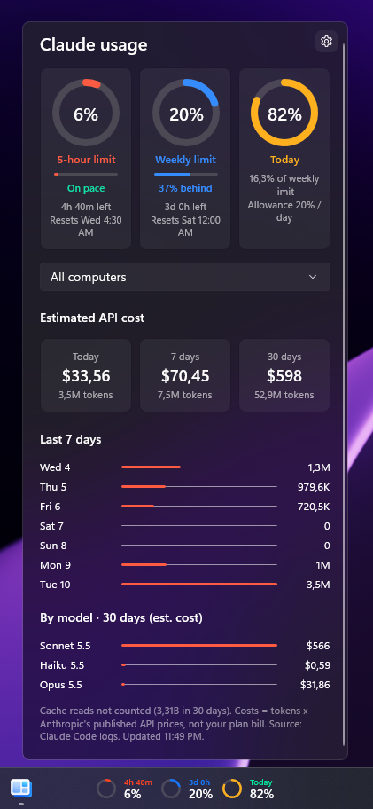

# Claude Usage

See how much of your Claude limits you have used, right on your Windows 11 taskbar.

Claude Usage is a widget for [WidBar](https://apps.microsoft.com/detail/9PKLDNM83TP9). A glance at the taskbar shows your 5-hour and weekly usage as small progress rings. Click it for details: reset times, estimated cost, and usage by day and by model.

  

> This is an unofficial, community project. It is not made by or affiliated with Anthropic.

## What you get

**On the taskbar**

- Progress rings for your **5-hour limit**, your **weekly limit**, and optionally **today's usage**, each with its percentage.
- Rings change colour as you use more: amber when you are getting close, red when you are nearly out.
- Choose which rings to show. If you turn them all off, the widget just shows "Claude Usage".

**In the flyout (click the widget)**

- Large rings for each limit, with the time left, the reset time and a small progress bar. A pace note tells you whether you are on pace, ahead or behind.
- Your extra usage credits, when you have them turned on.
- A picker to look at one computer or all of them (see *Using Claude on several computers*).
- **Estimated cost** for today, the last 7 days and the last 30 days, with the number of tokens behind each figure.
- A bar chart of the last 7 days.
- Usage by model over the last 30 days.

## Requirements

- Windows 11
- [WidBar](https://apps.microsoft.com/detail/9PKLDNM83TP9) from the Microsoft Store
- [Claude Code](https://claude.com/claude-code), signed in to your Claude account. Claude Usage reads its usage records and uses its sign-in to ask Claude for your limits.

## Install

1. Install WidBar from the Microsoft Store if you do not have it.
2. Install the Claude Usage package from this repository's Releases page.
3. Open WidBar, find **Claude Usage** in the widget catalog and drag it onto your taskbar. If it does not appear, open the **Layout** page in WidBar and press **Refresh**.

## First-time setup: sign in

Out of the box, the rings use rough estimates. To show your **real** limits, the same percentages and reset times you see in Claude:

1. Click the widget to open the flyout, then press **Sign in to Claude**. You can also do this from **Settings > Plan limits**.
2. Your browser opens so you can authorize. This is Claude Code's own sign-in.
3. When you finish, the widget refreshes and shows your real 5-hour and weekly numbers.

Settings shows which account is signed in (name, email and plan) so you can confirm the numbers are for the account you expect.

If Claude Code was not found on this computer, the button changes to **Get Claude Code** and opens the official page. Install it, then try again.

## Settings

Open the widget's settings from WidBar, or from the gear in the flyout. A live preview at the top shows the taskbar widget as you change things.

| Section | What you can do |
| --- | --- |
| **Plan limits** | See which account is signed in. Sign in or sign in again. |
| **Taskbar view** | Show or hide the 5-hour, weekly and daily rings. Show or hide the small labels above the percentages. |
| **Colours** | Choose the percentage where a ring turns amber (default 80) and red (default 95). |
| **Data** | Choose how often it refreshes (1, 5 or 15 minutes). Count cache reads in token totals (off by default). Point to a different Claude data folder. |
| **Token budgets** | Set 5-hour, weekly and daily budgets, in millions of tokens. They are used for the rings when you are not signed in. |

## Languages

The widget follows WidBar's language setting (or your Windows display language if WidBar is set to automatic). Available: English, Ukrainian, German, Spanish, French and Italian. Anything else shows English.

## Using Claude on several computers

Token counts, costs, history and model usage come from Claude Code's files on each computer, so by default every computer shows only its own. To see the total:

1. Pick a folder that all your computers can reach, such as a OneDrive or Syncthing folder or a network share. Keeping it in sync is up to you.
2. On each computer with the widget, set **Settings > Data > Shared folder** to that folder (the path can differ per computer). The widget writes one small file (`usage-<computer>.json`, token counts per 15 minutes and model, no prompts or file names) and reads the files of the others.
3. On a computer that cannot run the widget (a NAS, a Linux server), run `tools/export-usage.py <folder>` every few minutes, for example from cron. It writes the same kind of file.

When more than one computer has reported usage, the flyout shows a picker (**All computers**, or one computer) that filters the cost tiles, the 7-day chart and the model breakdown. The rings are not filtered: the 5-hour and weekly percentages always come from your account and already cover everything.

## Good to know

- **Real limits need sign-in.** Without it, the 5-hour and weekly rings compare your recent token use with the budgets you set in Settings. These are estimates, not your actual plan limits.
- **The daily ring is not a Claude limit.** Claude has no daily limit. When you are signed in, this ring shows how much of *today's share of your weekly limit* you have used. The share is what is left of your week right now, divided by the days remaining, and today's part of your weekly percentage is estimated from your Claude Code usage. Without sign-in it compares today's tokens with the daily budget you set. Either way it is a personal gauge.
- **Costs are estimates.** They are your tokens multiplied by Anthropic's published API prices, which are read from Anthropic's pricing page and refreshed once a day. This is what the same usage would cost on pay-as-you-go API pricing. It is **not** your bill: a Pro or Max subscription is a flat fee.
- **Claude Code usage only.** Token counts and costs come from Claude Code on this computer. Chats on claude.ai and usage on other computers are not included in them. The 5-hour and weekly percentages come from your account, so they count everything Claude counts.
- **It can break.** The widget uses a Claude endpoint that is not officially documented. If Claude changes it, the rings fall back to estimates until the widget is updated.

## Privacy

- Your usage records are read **on your computer** from Claude Code's local files (`.claude\projects`). They are not uploaded anywhere.
- To get your real limits, the widget reads the sign-in token that Claude Code stores on your computer and sends it **only to Anthropic** (`api.anthropic.com`). The token is never written to a file, logged or shown.
- Your account name and email, shown in Settings, are read from Claude Code's local files. They stay on your computer.
- The only other request the widget makes is downloading Anthropic's public pricing page, to keep cost estimates accurate. It sends nothing about you.
- The widget has no analytics or telemetry.

## Troubleshooting

| Problem | What to try |
| --- | --- |
| The widget is not in the WidBar catalog | Open **Layout** in WidBar and press **Refresh**. |
| Rings show estimates, not real limits | Open the flyout or Settings and press **Sign in to Claude**. |
| It says Claude Code was not found | Press **Get Claude Code**, install it, then reopen Settings. |
| It says no usage was found | Use Claude Code once, or set the right folder in **Settings > Data > Claude data folder**. |
| The numbers do not match Claude exactly | Wait for the next refresh. Plan limits are asked for at most every 5 minutes. |
| Sign-in worked before but the rings are estimates again | Your sign-in expired. Press **Sign in again** in Settings. |
| The preview looks cut off on the taskbar | Fewer rings take less space. Turn one off in **Taskbar view**. |
